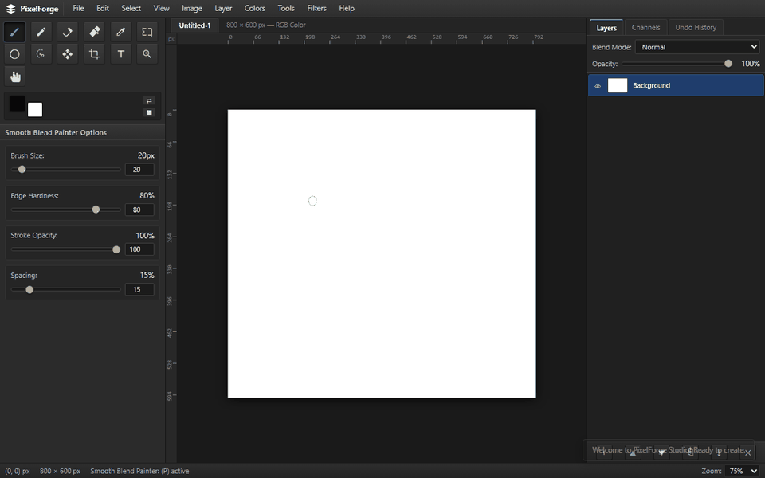
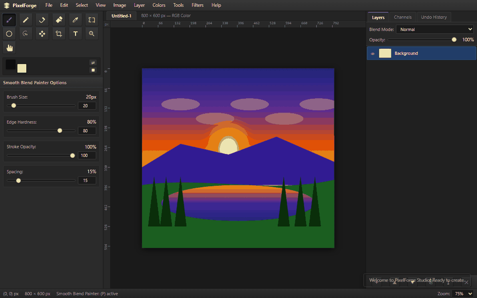
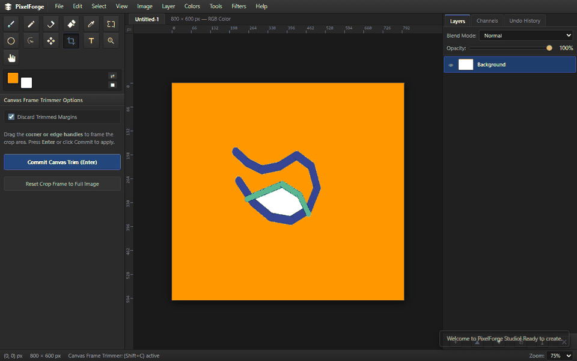

# PixelForge Studio

PixelForge Studio is an open-source, client-side digital raster graphics editor that runs entirely in the browser using HTML5 Canvas, JavaScript (ES6+), and CSS. It requires no installation, external build systems, or server dependencies.

This project was built as an open-source benchmark to test and demonstrate autonomous multi-agent software engineering capabilities using AI agent swarms.

---

## 🎬 Live Demos & Feature Showcase

### 1. Interactive Drawing, Flood Fill & Marquee Selection
Continuous soft brush strokes with edge hardness, flood fills with color tolerance, 1px pixel writing, and antialiased selection with animated marching ants:



### 2. Photo Color Grading, Levels & Tonal Adjustments
Non-destructive photo editing with 8-bit Brightness & Contrast LUTs, HSL saturation boosting, histogram Levels with gamma curve mapping, and cinematic vignette:


### 3. Multi-Layer Photo Compositing & 16 Blend Modes
Multi-layer workflows with real-time blend mode switching (`Multiply`, `Screen`, `Overlay`, `Color Dodge`), layer opacity tuning, and typography rasterization:



### 4. Canvas Frame Trimming & Live Filter Previews
Interactive 8-handle crop framing with rule-of-thirds grid, canvas document resizing, and modal filter dialogs with live canvas preview toggles:



---

## Inspiration & Goals

Digital raster graphic suites traditionally require large native desktop runtimes to execute layer blending, convolution filtering, and pixel manipulation. PixelForge Studio explores whether these creative workflows can run entirely inside modern web browsers using standard web technologies.

Inspired by classic open-source raster graphics tools, PixelForge Studio implements:
- Multi-layer compositing with 16 distinct blend modes.
- Real-time convolution filters and mathematical adjustments.
- Interactive raster selection masks with marching ants visualization.
- Full undo/redo history state tracking.
- Client-side project serialization and high-resolution export.

---

## Toolset

PixelForge Studio provides 13 core tools designed with intuitive, functional names:

1. **Smooth Blend Painter** (`P`): Continuous soft brush strokes with adjustable size, hardness, and opacity.
2. **Precision Pixel Writer** (`N`): Sharp, unaliased single-pixel / grid writing for pixel art.
3. **Alpha Clearing Tool** (`Shift+E`): Restores canvas transparency by clearing pixel alpha.
4. **Contiguous Area Flood** (`Shift+B`): Queue-based 32-bit flood fill with color tolerance.
5. **Pixel Color Sampler** (`O`): Eyedropper with live loupe preview to sample composite colors.
6. **Box Area Selector** (`R`): Rectangular marquee selection generating an 8-bit mask.
7. **Oval Area Selector** (`E`): Antialiased elliptical selection boundary.
8. **Freeform Outline Selector** (`F`): Polygonal and freehand lasso contour selection.
9. **Layer Position Shifter** (`M`): Interactive spatial translation of active layer offsets.
10. **Canvas Frame Trimmer** (`Shift+C`): 8-handle framing bounding box for trimming document dimensions.
11. **Typography Rasterizer** (`T`): Font rendering with customizable styling onto new layers.
12. **Canvas Magnifier** (`Z`): Viewport zoom scaling centered on mouse coordinates.
13. **Viewport Canvas Scroller** (`H`): Hand panning across canvas coordinates.

---

## Features

- **Layer System**: Unlimited layers with opacity, visibility toggle, layer locking, alpha locking, and reordering.
- **Blend Modes**: Normal, Multiply, Screen, Overlay, Darken, Lighten, Color Dodge, Color Burn, Hard Light, Soft Light, Difference, Exclusion, Hue, Saturation, Color, Luminosity.
- **Filter Suite**: Brightness/Contrast, Exposure, HSL adjustments, Levels with gamma curve, 1D Separable Gaussian Blur, Sobel Edge Detect, Sharpen, Sepia, Desaturate, and Mosaic.
- **Project Format**: Native `.pforge` project saving (JSON manifest with layer metadata and base64 pixel data).
- **Export Formats**: PNG, JPEG, and WebP with quality compression controls.
- **Zero Dependencies**: Pure HTML5 Canvas and vanilla JavaScript. Runs directly from `file:///` or any static HTTP server.

---

## Running Locally

Open `index.html` directly in any web browser, or serve it using Python's static HTTP server:

```bash
# Start a local static web server
python -m http.server 8000

# Open in browser
http://localhost:8000
```

---

## Testing & Verification

The repository includes automated test suites executed via headless Chromium:

- `verify.py`: Runs core architecture and unit verification (43 tests).
- `run_live_canvas_e2e.py`: Simulates actual DOM pointer interactions across all 13 tools.
- `run_cross_test.py`: Validates all menus, actions, filters, and layer operations (63 tests).

Run the tests using Python:

```bash
python verify.py
python run_live_canvas_e2e.py
python run_cross_test.py
```

---

## License

This project is licensed under the MIT License.
